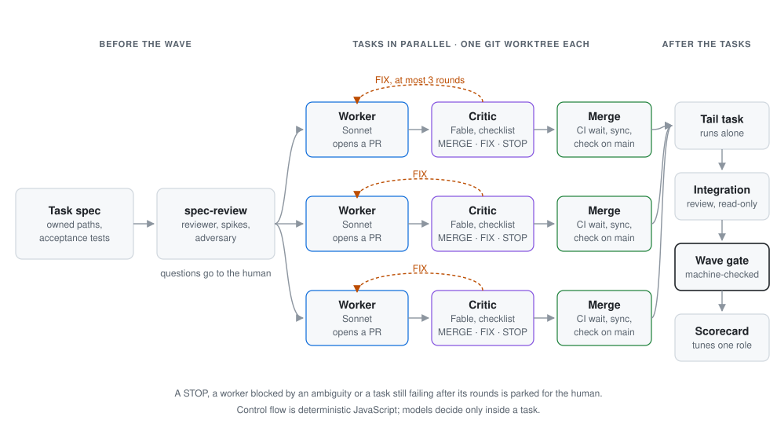

<div align="center">

# agent-loop

**Build a codebase with parallel Claude Code agents: one worker per task, a separate critic for every PR, CI-gated
merges, and a scorecard after every wave.**

[](https://github.com/EdanBarrios/agent-loop/actions/workflows/check.yml)
[](LICENSE)




</div>

Used to build Warden, a civic-data web app: 53 tasks over 6 waves, 72% approved by the critic on the first PR, no
merged PR reverted, about 23M tokens ([results](RESULTS.md)). The loop also built its own v2 from a spec
([specs](docs/agent-loop-v2/)). One author, one machine: read [Limitations](#limitations) first.

## Why

A single agent session working down a long spec drifts. It reviews its own code, it decides by itself what to do
next, and nobody measures it. agent-loop splits that apart:

- **Separate roles.** The agent that writes the code never approves it. A critic on a different model reviews every
  PR against a fixed checklist.
- **Deterministic control flow.** A plain JavaScript workflow schedules tasks, enforces dependencies, counts fix
  rounds and decides what happens next. Models decide only inside a task.
- **Measured, then tuned.** Every wave ends with a scorecard (first-pass rate, fix causes, critic misses, tokens and
  minutes per role) and a written rule for when to move a role's model up or down.

## The roles

| Role | Default model | What it does |
|---|---|---|
| spec-review | Sonnet reviewer, Haiku spikes, Fable adversary | Reads the wave against the spec before it runs, checks each external fact with a spike, and asks the human only the questions that would change the work |
| Worker | Sonnet, high effort | Builds one task in its own git worktree, touching only the paths the task owns, and opens a PR |
| Critic | Fable, high effort | Reviews the PR against a fixed checklist (security included) and returns MERGE, FIX or STOP, with findings at file:line |
| Merge | script, run by a Haiku relay | Waits for CI, syncs with the default branch, merges, checks main and reverts once if main goes red |
| Integration review | Fable, read-only | After the tail task, reads the whole wave's diff for duplication, layering, security and dead code |
| Gate and scorecard | script | Every task merged or parked, main green, no open escalations; then the per-role numbers |

## Quickstart

Prerequisites: [Claude Code](https://claude.com/claude-code) with workflows, the
[hookify](https://github.com/anthropics/claude-plugins-official/tree/main/plugins/hookify) plugin, `gh` signed in, Node 24,
Python 3, and a GitHub repo with CI.

```sh
git clone https://github.com/EdanBarrios/agent-loop ~/dev/agent-loop
cd ~/dev/agent-loop && npm ci && npm run check
~/dev/agent-loop/install.sh /path/to/your/repo     # links the loop into .claude/, tracks nothing
```

Then, in your repo:

1. Fill in `.claude/loop.local.json` (repo, check command, CI workflow name; see the
   [config table](docs/OPERATING.md#project-config)).
2. Write a task spec: fixed decisions, then waves of tasks, each with an id, owned paths, dependencies and a written
   acceptance test. [This spec](docs/agent-loop-v2/2026-10-30-agent-loop-v2-tasks.md) is a real example.
   `node ~/dev/agent-loop/scripts/spec-lint.js <spec>` checks it.
3. Start Claude Code in the repo and ask it to read `~/dev/agent-loop/docs/OPERATING.md` and run wave 1. The session
   builds the args with `scripts/wave-args.js`, runs the `wave-loop` workflow, reports the gate and writes the
   scorecard.

The [operating manual](docs/OPERATING.md) is what the session reads before a wave. It has every rule and setting.

## How it works

- **Scheduling.** Tasks run in priority order (longest first) up to `maxChains` at once (default 6). A task starts
  when its dependencies have merged. The tail task, which integrates the wave, runs alone at the end.
- **Isolation.** Each worker has its own git worktree and branch. Heavy commands go through `slot.sh`, a machine-wide
  semaphore, so parallel installs and test runs cannot exhaust memory, even across projects.
- **Review.** The critic's checklist covers spec conformance, owned paths, the acceptance test committed
  before the code, no skipped tests or lowered test count, and security for anything touching the network, a database or secrets. A high-severity finding turns
  MERGE into FIX. FIX goes back to the worker, at most three rounds; a second critic pass is skipped when the only
  change since the approved head is CI-only, such as formatting.
- **Merging.** `merge-pr.js` syncs, waits for CI, merges, and verifies main. When main is red it reverts once and
  reopens the task. A lost merge output triggers a read-only state check, never a second merge.
- **Guardrails.** Hookify rules block commits and pushes to the default branch, force pushes, and secrets in file
  writes, for every agent and for the session itself.
- **Measurement.** `loop-scorecard.py` turns a run's output into a per-wave scorecard and prints the rule for moving
  one role's model or effort one notch, only after two waves in a row show the same problem.

## What I learned

Measured on real waves; the details and the caveats are in [RESULTS.md](RESULTS.md).

- **Shape waves wide, not deep.** Each dependency hop waits for review, CI and a merge, about 15 minutes. Deep chains
  ran 24 to 25 minutes per merged task against 10 for a wide wave.
- **Tests that pin an earlier wave's output block later waves.** Most of Warden wave 3's relaunches (7.6M tokens,
  6.4 hours) came from that, so `spec-review` now looks for it before the wave starts.
- **Keep the machine quiet during a wave.** One worker took 59 minutes and 15.9M tokens beside a heavy job,
  against 26 minutes and 2.1M for a task of the same size.

## Limitations

- Claude Code only. The loop is a Claude Code workflow plus agent definitions, not a standalone program.
- GitHub only (`gh`, Actions checks, branch protection).
- Not cheap: about 316K to 565K tokens per task on Warden, including review and relaunches.
- Built and tuned by one person on one 8 GB Mac, against a handful of projects. The defaults reflect that.
- The wide-wave rule rests on observed waves, not on a controlled comparison.
- Paths in the manual assume the loop is cloned to `~/dev/agent-loop`.

[Operating manual](docs/OPERATING.md) · [Results](RESULTS.md) · [Scorecards](docs/warden/) · [Loop specs](docs/agent-loop-v2/)

MIT © Edan Barrios. Not affiliated with Anthropic.
