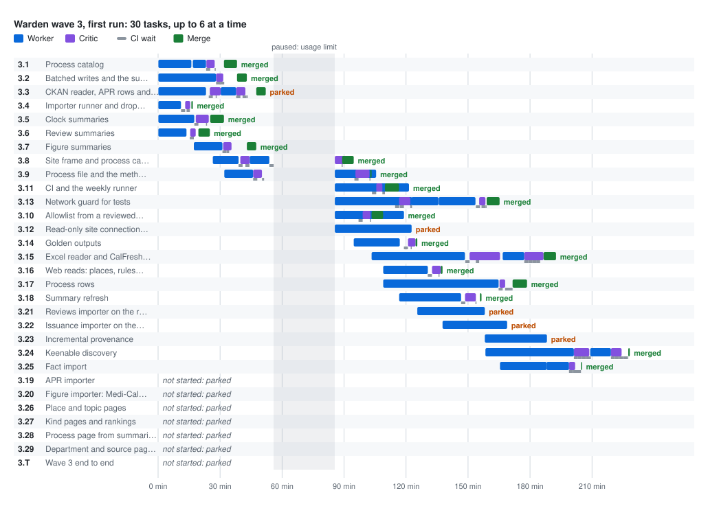

# Results

What the loop did on a real project, taken from the per-wave scorecards in [`docs/warden/`](docs/warden/).
[Warden](https://govwarden.vercel.app) is my own civic-data site (Next.js, Postgres; live, code private); the loop
opened 61 of its 145 merged PRs (waves 1 to 4). Measurements come first, then what I concluded from them, kept apart on purpose.

## Measurements: Warden waves 1 to 4 (13 to 17 Nov 2026)

| Wave | Loop | Tasks | First-pass MERGE | Fix items by cause | Reverted after MERGE | Gate | Tokens |
|---|---|---|---|---|---|---|---|
| [1](docs/warden/2026-11-13-wave-1-loop.md) | before 2.2 | 6 | 6/6 | none | 0 | PASS | 0.99M |
| [1b](docs/warden/2026-11-13-wave-1b-loop.md) | 2.2.0 | 4 | 3/4 | defect 1 | 0 | PASS | 1.02M |
| [1c](docs/warden/2026-11-13-wave-1c-loop.md) | 2.2.0 | 4 | 2/4 | spec_miss 2 | 0 | PASS | 1.20M |
| [1d](docs/warden/2026-11-14-wave-1d-loop.md) | 2.2.1 | 2 | 1/2 | defect 1 | 0 | FAIL (1) | 0.58M |
| [2](docs/warden/2026-11-15-wave-2-loop.md) | 2.2.1 | 7 | 6/7 | defect 3 | 0 | PASS | 2.21M |
| [3](docs/warden/2026-11-16-wave-3-loop.md) | 2.3.0, 2.3.1 | 30 | 20/30 | defect 9, spec_miss 10, loop 2 | 0 | PASS after 5 runs (2) | 16.96M |
| [4](#wave-4-nothing-merged) | 2.3.1 | 19 | 6/6 reviewed | none | 0 | FAIL (3) | 2.75M |
| **Total** | | **72** | **44/59 reviewed (75%)** | | **0** | | **25.71M** |

1. Wave 1d failed its gate on a merge the loop could not run (the merge relay was blocked), not on the code. The
   PR (the critic had approved it on round 2) was merged outside that run.
2. Wave 3's first run merged 19 of 30 tasks. Four relaunches merged the rest.
3. Wave 4 merged nothing; see below.

"First-pass MERGE" is the share of tasks whose first PR the critic approved. "Fix items" are what the critic asked
for, by cause: `defect` (the code was wrong), `spec_miss` (the code did not do what the spec says), `loop` (the loop
itself was at fault). Waves before 2.3.0 did not count defects that escaped into later fixes, so the critic-miss
figure for those waves is reverts only.

### Wave 4: nothing merged

19 tasks, 2.75M tokens, 93 minutes, 0 merged by the loop. The critic approved all 6 PRs it reviewed on the first pass,
then two failures stopped the wave. The permission system refused the merge script (the preflight had passed, because
it ran the script as a dry run, which the permission check judges differently), and the loop rightly stopped running
merges after one refusal. Then the weekly usage limit ran out and 9 workers returned nothing. The 8 finished PRs were
merged by hand; the rest of the wave was finished outside the loop. Both failures are in the [red team](docs/RED-TEAM.md)
(finding 5) with their fixes.

### Wave 3, first run

Drawn with `python3 -I scripts/wave-timeline.py <run output> --titles`. The shaded stretch (about 30 minutes) is a
usage-limit pause, not loop time.

### Wave 3 cost in detail

| Run | Tasks | Agents | Tokens | Wall clock |
|---|---|---|---|---|
| Spec review | 30 | 13 | 1.28M | 56 min |
| 1 | 29 + tail | 142 | 9.34M | 236 min |
| 2 (relaunch) | 10 + tail | 42 | 2.41M | 77 min |
| 3 (relaunch) | 5 + tail | 45 | 3.00M | 110 min |
| 4 (relaunch) | 2 + tail | 18 | 1.25M | 119 min |
| 5 (tail) | tail | 12 | 0.95M | 77 min |
| **Total** | 30 | 259 | 16.96M | 10.3 h |

About 565K tokens per task, against 316K in wave 2. The four relaunches (7.6M tokens, 383 minutes) were caused by
the spec and the loop, not by the code the workers wrote.

## What I concluded, and what changed

**Tests that pin an earlier wave's output block later waves.** Wave 3 replaced code whose exact output was pinned
by tests that earlier tasks owned (`toEqual` on result shapes). A worker may edit only the paths its task owns, so
seven tasks stopped to ask permission across three runs. Change in 2.3.1: `spec-review` now looks for a task whose
change breaks a test another task owns, and asks for a named editor in the spec before the wave starts.

**Answers the critic cannot see do not count.** The human's answer to a blocked worker went into the relaunch notes,
which the critic did not read, so the critic stopped the same task again. Change in 2.3.1: the critic sees the
session's answers for a relaunch.

**A lost merge output is not a failed merge.** One merge relay was killed after its PR had merged, and the task was
parked anyway. Change in 2.3.1: a lost output triggers a read-only state check instead of a retry or an escalation.

**Wide waves beat deep ones.** On an earlier project (a private client repo, not published), waves whose
dependency chains ran 4 to 5 tasks deep took 24 to 25 minutes per merged task, against 10 for a wide wave. Each hop
waits for review, CI and a merge before the next worker can start. Change (3 Nov 2026): `spec-lint` warns on chains deeper
than 2 and the manual says to shape waves wide. Not yet validated: there is no controlled before/after comparison
of the same work shaped both ways.

## What these numbers do not show

- One project, one author, one machine (an 8 GB Mac). No comparison against a single agent doing the same spec.
- The critic's 0 reverts means no merged PR had to be undone; it does not prove the critic missed nothing.
- Token counts are subagent tokens from the Workflow runs, not dollars.
